<p align="center">
  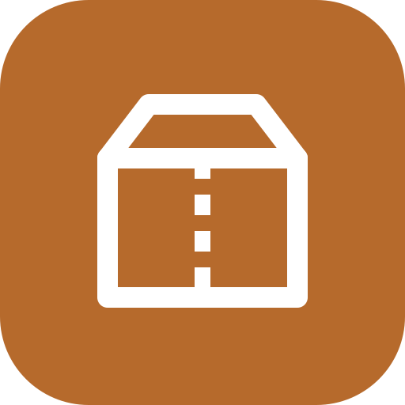
</p>

<h1 align="center">PackMate</h1>

<p align="center"><b>Type in the size. Get a box ready to cut.</b><br>
Packaging templates for your Brother ScanNCut, Cricut, Silhouette or cutting plotter. Free, private, works offline.</p>

<p align="center">
  <a href="https://grafffooo.github.io/PackMate/"><b>Open the web app</b></a> ·
  <a href="https://github.com/grafffooo/PackMate/releases/latest"><b>Download for macOS, Windows, Linux</b></a> ·
  <a href="#run-it-on-your-nas-docker">Docker</a>
</p>

<p align="center">
  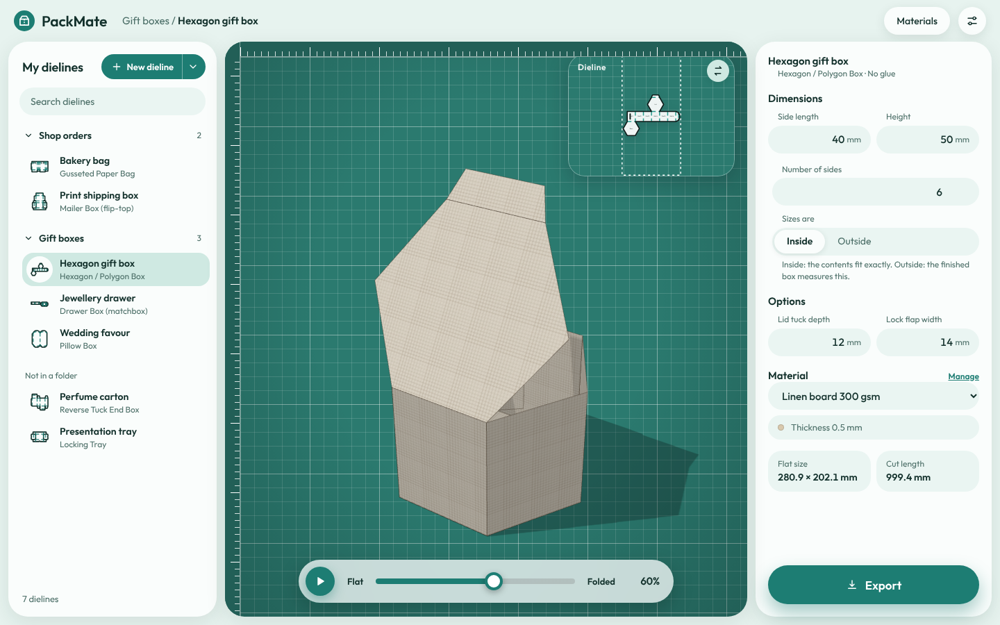
</p>

## What is PackMate?

PackMate draws **dielines**: the flat cut-and-fold patterns that turn a sheet of card or paper into a box,
sleeve, bag or envelope. Pick a shape, type the size you need, and PackMate calculates the unfolded
pattern (cut lines, fold lines, glue flaps), shows you how it folds in 3D, and exports a file your
cutting machine understands.

It's made for people who cut their own packaging: hobbyists with a **Brother ScanNCut, Cricut or
Silhouette**, small shops, and anyone with a plotter or a print shop around the corner.

- **No account, no subscription, no upload.** Your designs stay on your device.
- **Works offline** once opened, on desktop, phone, tablet or your home server.
- **Free and open source** (GPL-3.0).

## What you can do

### Pick a shape, type the size

18 generators, most of them **glue-free**, so you can assemble the box with just folds, tabs and slots.
Each one is tagged *No glue* or *Needs glue* so you know before you cut.

| Category | Shapes |
| --- | --- |
| Boxes | Reverse Tuck End, Straight Tuck End, Tuck-Lock Box, Snap-Lock Bottom Box, Lid and Base Box |
| Mailers & Trays | Mailer Box (flip-top), Locking Tray, Drawer Box (matchbox) |
| Sleeves & Inserts | Sleeve, Slotted Dividers, Compartment Tray |
| Shapes | Hexagon / Polygon Box (3 to 8 sides), Pyramid (3 to 8 sides), Cylinder Box |
| Gift & Specialty | Pillow Box, Gable Box with handle |
| Envelopes & Bags | Card Envelope, Gusseted Paper Bag |

<p align="center">
  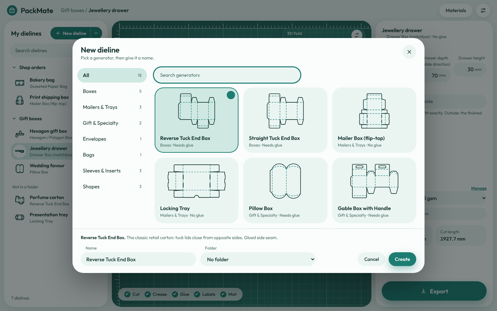
</p>

### Work on a cutting mat

Your dieline sits on a virtual **cutting mat** with the outline of your machine's mat, so you see at a
glance whether it fits. Switch layers on and off (cut, crease, glue, labels), and zoom or pan like a map.
Sizes can be **inside or outside** measurements, in **millimetres or inches** (type `3 1/2` or `40mm`).

<p align="center">
  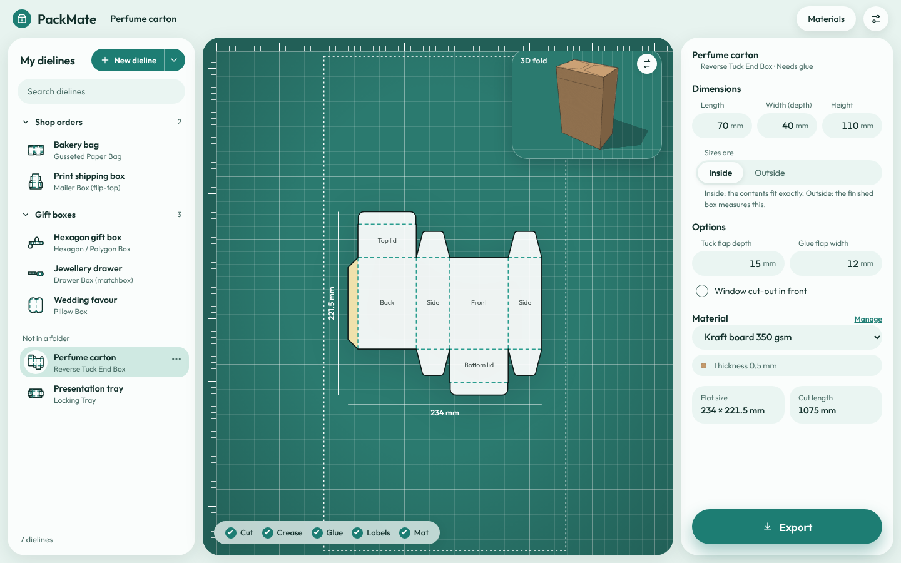
</p>

### See it fold before you cut

Drag the **fold slider** (or press play) to watch the flat pattern fold into the finished box, with a
realistic shadow. Boxes made of several loose parts, such as a lid and base, or dividers, assemble
themselves in the preview.

<p align="center">
  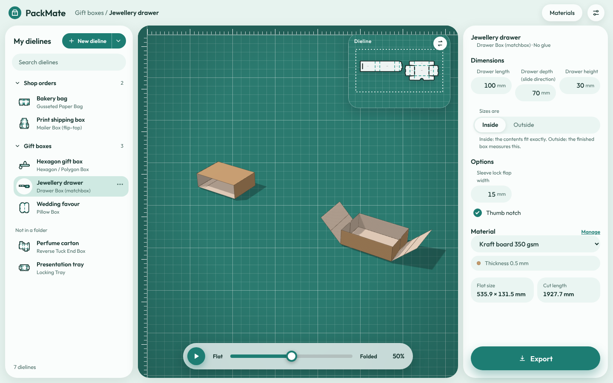
</p>

### Keep everything organised

Group your designs in **folders**, rename them in place, duplicate and search. Everything is saved
automatically on your device.

<p align="center">
  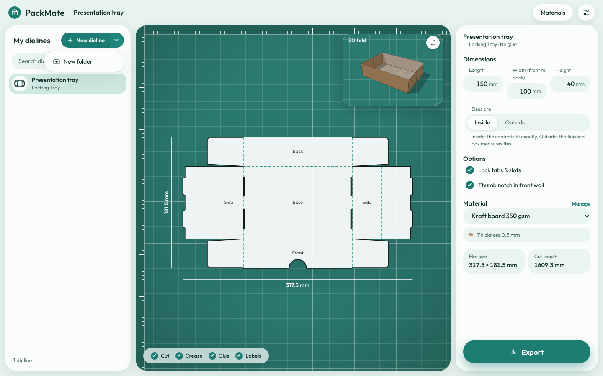
</p>

### Describe your material

The **materials library** has kraft, white, black and E-flute board to start with. Add your own with its
**thickness** (PackMate uses it so folds close without bulging), weight and colour, and even upload a
**texture** for the outside and inside face to see on the 3D box.

<p align="center">
  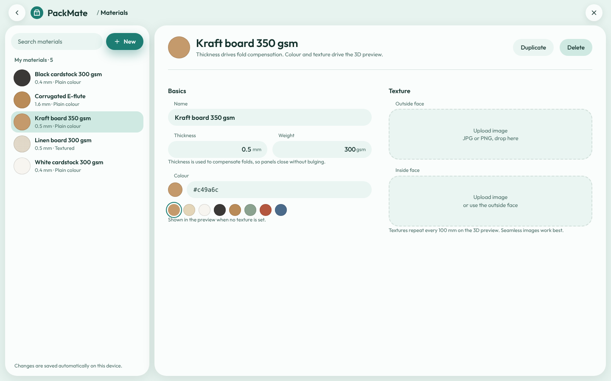
  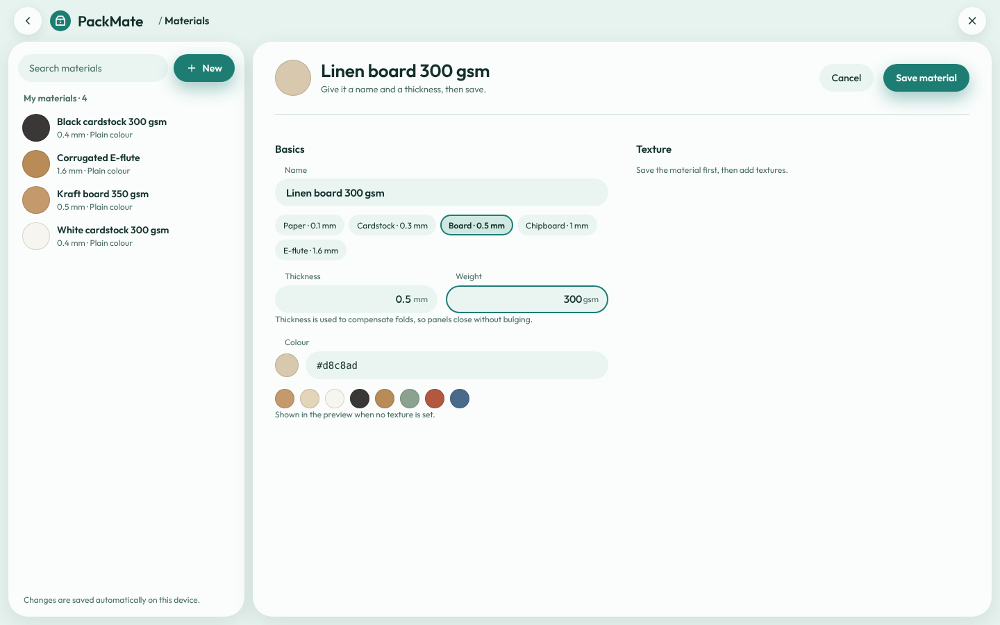
</p>

### Export for your machine

Export **SVG** (real millimetres, separate cut and crease layers), **PDF** (layered, for print shops) or
**DXF** (plotters, laser cutters, CAD). Pick your machine and PackMate sets the sensible defaults:
creases on their own layer for a scoring tool, or turned into perforated cuts for machines without one.

<p align="center">
  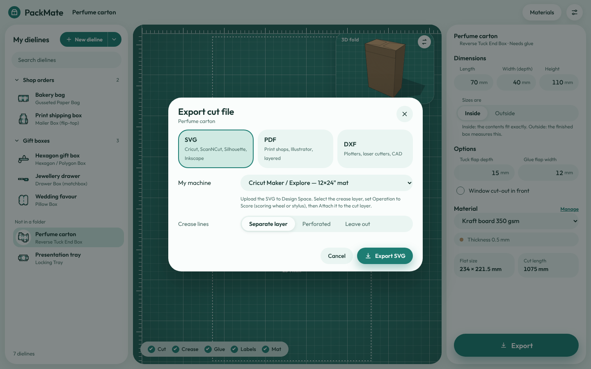
</p>

### Make it yours

<table>
  <tr>
    <td align="center">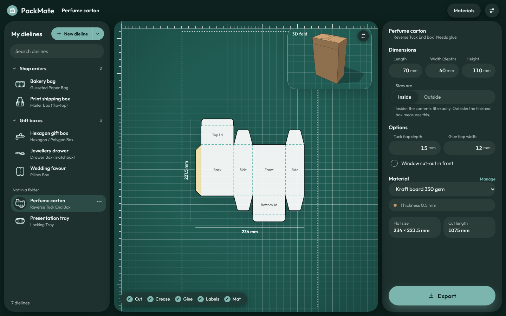<br><sub>Dark mode</sub></td>
    <td align="center">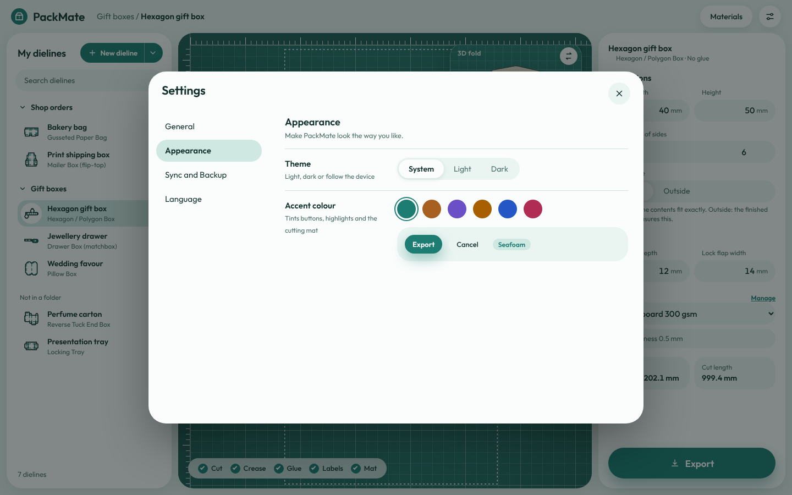<br><sub>Light, dark or follow your device, plus six accent colours</sub></td>
  </tr>
</table>

Pick an accent colour and the whole app, including the cutting mat, takes on its tint:

<table>
  <tr>
    <td>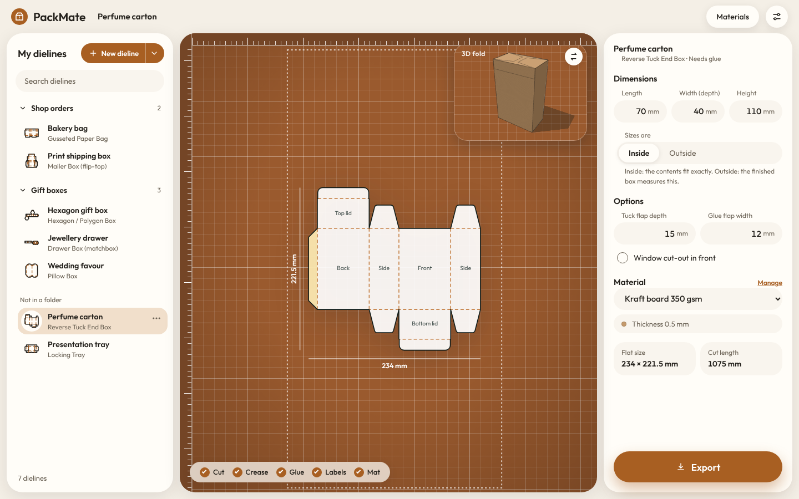</td>
    <td>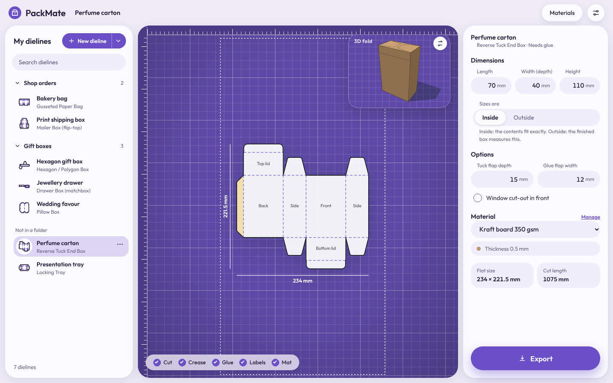</td>
    <td>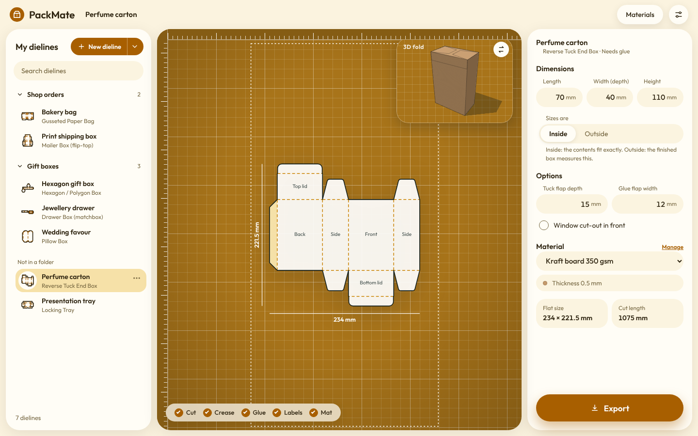</td>
    <td>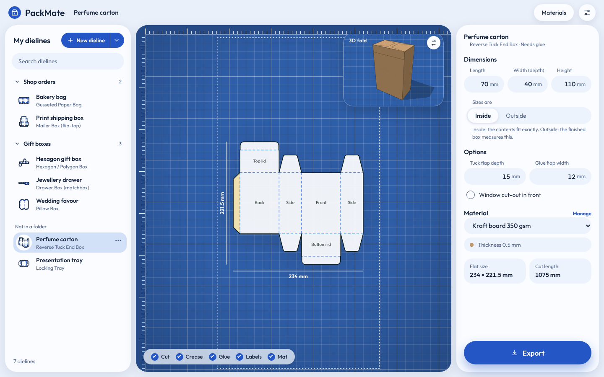</td>
    <td>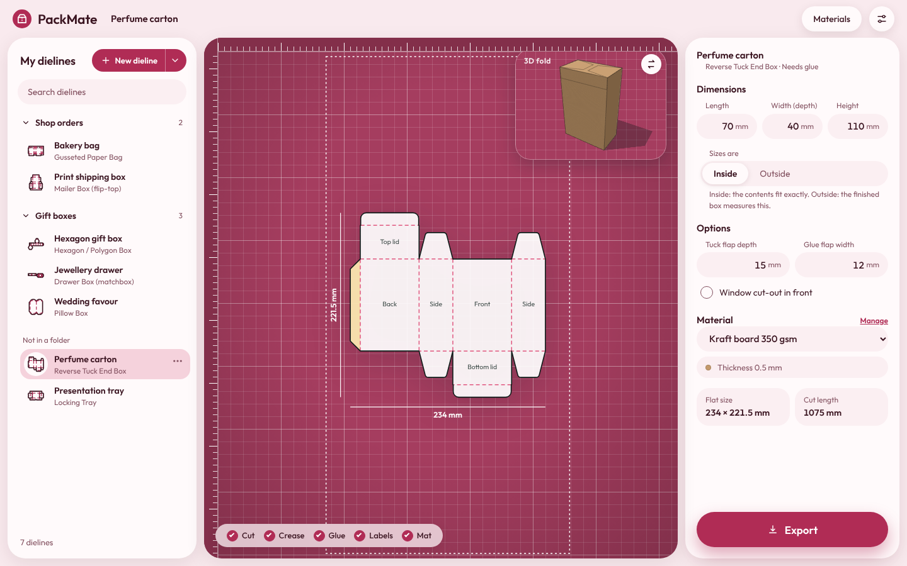</td>
  </tr>
  <tr align="center">
    <td><sub>Terracotta</sub></td><td><sub>Lavender</sub></td><td><sub>Marigold</sub></td><td><sub>Ocean</sub></td><td><sub>Rose</sub></td>
  </tr>
</table>

### Take it with you

- **Backup and restore** everything (designs, folders, materials, textures) as one file.
- **Sync folder** (Chrome and Edge on a computer): point PackMate at a folder that iCloud Drive, Google Drive,
  OneDrive or Dropbox already syncs, and your library follows you between computers.
- **English and Slovak**, with more languages planned.
- **Works on your phone**: install it from your browser's menu and it behaves like an app.

<p align="center">
  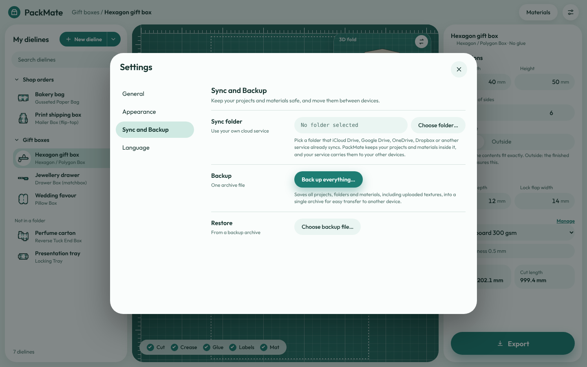
  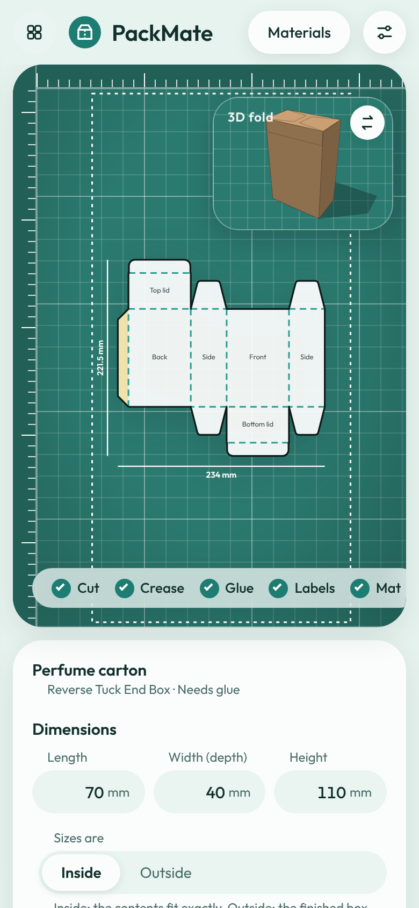
</p>

## How to use it

1. **Create.** Press **New dieline**, pick a shape from the gallery, give it a name and (if you like) a folder.
2. **Set the size.** Type the length, width and height of what you want to put in the box. Choose inside or
   outside measurements, and pick your **material** so the folds are calculated for its thickness.
3. **Check it.** Look at the dieline on the mat and drag the fold slider to see the finished box in 3D. If a
   value is out of range, PackMate tells you.
4. **Export.** Press **Export**, choose SVG, PDF or DXF and your machine, and save the file.
5. **Cut.** Open the file in your machine's software and cut (see the tips below).

> First time? Open **Settings** (the sliders icon, top right) and choose your **units** and **machine**. The
> welcome screen offers the same options.

### Tips for your cutting machine

- **Brother ScanNCut** (CanvasWorkspace): import the SVG. Without an embossing or scoring tool, export with
  *Perforated* creases; otherwise set the crease layer to *Draw* with a pen as a fold guide.
- **Cricut** (Design Space): upload the SVG, select the crease layer, set it to **Score**, then select both
  layers and **Attach** them.
- **Silhouette Studio:** use *Cut by line color*: red is cut, blue is score or perforate.
- **Print shops and plotters:** use the layered PDF or the DXF.

## Get PackMate

### In your browser

Open **<https://grafffooo.github.io/PackMate/>**. To use it like an app, choose *Install PackMate* in the
address bar (Chrome, Edge) or *Add to Home Screen* on your phone. It then works offline.

### Desktop app for macOS, Windows and Linux

Download the installer for your system from the **[latest release](https://github.com/grafffooo/PackMate/releases/latest)**.

The installers are **not signed** yet, so your system will ask for confirmation the first time:

- **macOS:** open the `.dmg` and drag PackMate to Applications. On first launch, right-click the app and choose
  **Open**, then **Open** again. (Or: System Settings > Privacy & Security > **Open Anyway**.)
- **Windows:** run the installer. If *Windows protected your PC* appears, click **More info**, then **Run anyway**.
- **Linux:** make the `.AppImage` executable and run it, or install the `.deb` (`sudo apt install ./PackMate_*.deb`)
  or `.rpm` (`sudo dnf install ./PackMate-*.rpm`).

### Run it on your NAS (Docker)

PackMate is a tiny website, so any home server can host it for your whole household:

```bash
docker run -d --name packmate -p 8080:80 --restart unless-stopped ghcr.io/grafffooo/packmate:latest
```

Then open `http://<your-nas>:8080` from any device. The image supports Intel/AMD (amd64) and ARM (arm64) machines
such as Synology, QNAP, Unraid and Raspberry Pi. With Docker Compose:

```yaml
services:
  packmate:
    image: ghcr.io/grafffooo/packmate:latest
    ports: ["8080:80"]
    restart: unless-stopped
```

Each address keeps its own library (the data lives in the browser you use), so use the backup and restore
feature to move designs between, say, the NAS site and a desktop app.

## A tour of every screen

<table>
  <tr>
    <td align="center">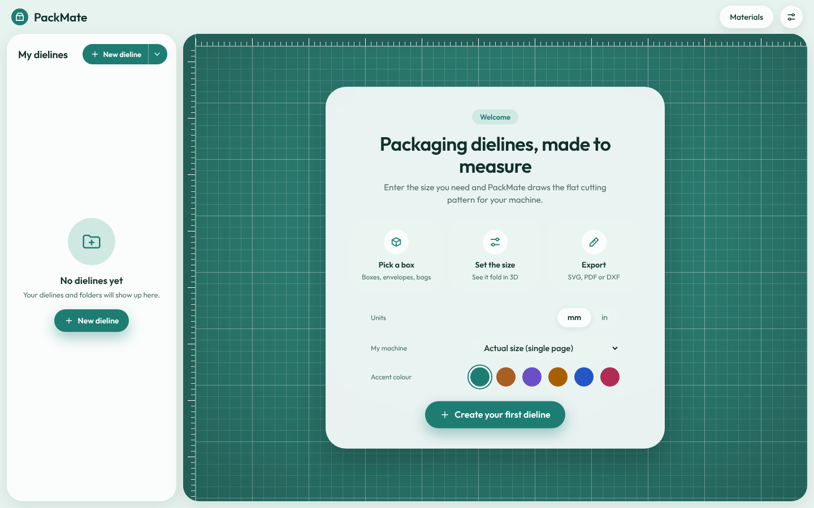<br><sub>Welcome: choose units, machine and accent colour</sub></td>
    <td align="center">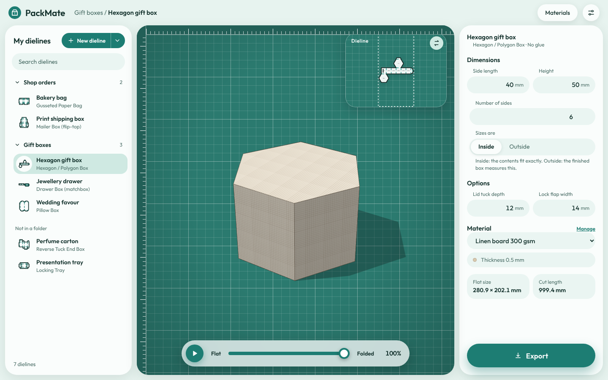<br><sub>The finished box in 3D</sub></td>
  </tr>
  <tr>
    <td align="center">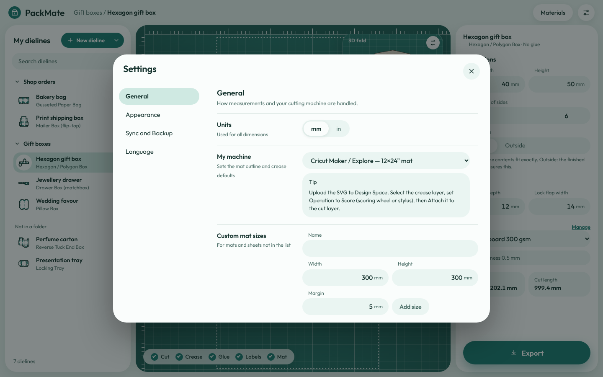<br><sub>Settings: units, your machine, custom mat sizes</sub></td>
    <td align="center"><br><sub>Settings: theme and accent colour</sub></td>
  </tr>
  <tr>
    <td align="center"><br><sub>Settings: sync folder, backup and restore</sub></td>
    <td align="center">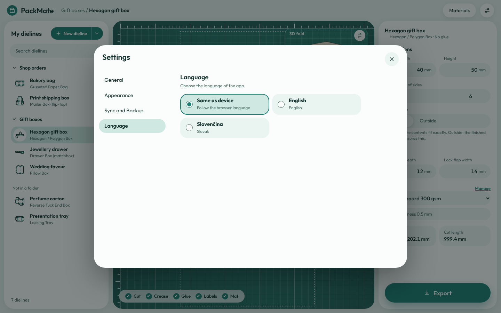<br><sub>Settings: language</sub></td>
  </tr>
  <tr>
    <td align="center"><br><sub>A new material</sub></td>
    <td align="center">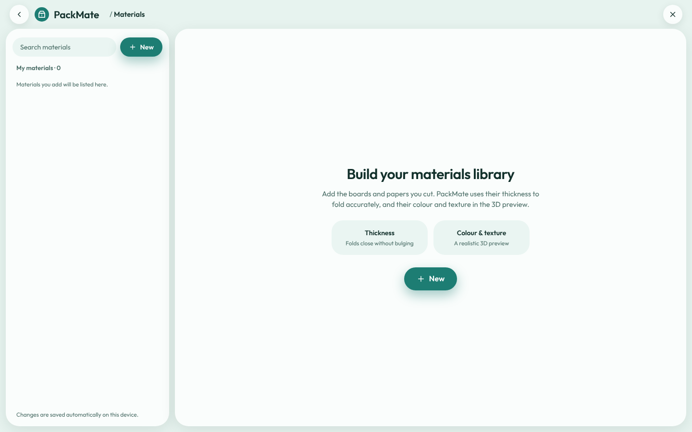<br><sub>The materials library before you add anything</sub></td>
  </tr>
  <tr>
    <td align="center">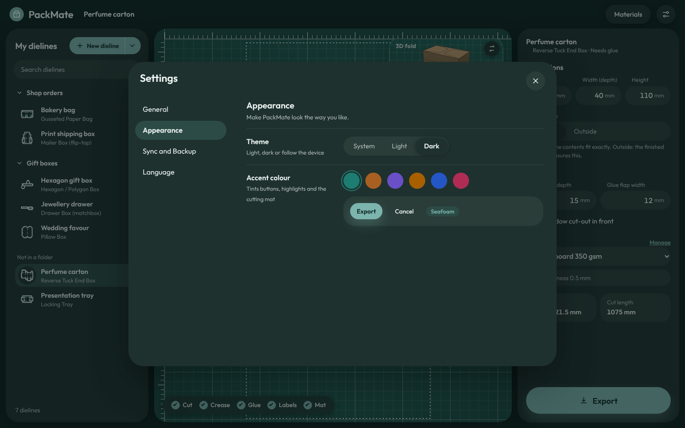<br><sub>Dark mode settings</sub></td>
    <td align="center"><br><sub>The New dieline menu</sub></td>
  </tr>
</table>

## Questions

**Is it really free?** Yes. PackMate is open source under the GPL-3.0 licence.

**Where are my designs stored?** On your own device, inside the browser or desktop app. Nothing is sent anywhere.
Use **Backup** to keep a copy, or the **sync folder** to share them between computers.

**Do I need glue?** Many shapes need none; the gallery tags each shape *No glue* or *Needs glue*.

**Which paper or card should I use?** Anything your machine can cut and fold. Pick the closest entry in the materials
library, or add your own with its measured thickness. Thicker material needs a thickness value so folds close properly.

**Will it fit my mat?** Choose your machine in Settings; the dieline view outlines its mat so you can see if the design fits.

**Can I add my own artwork?** Not yet; it's planned (see the roadmap).

## What's next

Laser-cut boxes, more languages, your own artwork with print-and-cut PDFs, and more shapes. See the
**[roadmap](docs/ROADMAP.md)**, and tell us what you need most by commenting on the roadmap issues ([#2 laser-cut boxes](https://github.com/grafffooo/PackMate/issues/2), [#3 languages](https://github.com/grafffooo/PackMate/issues/3), [#4 your own artwork](https://github.com/grafffooo/PackMate/issues/4), [#5 more shapes](https://github.com/grafffooo/PackMate/issues/5)).

## For developers

Build instructions, architecture, how to add a shape and how releases work are in
**[docs/DEVELOPMENT.md](docs/DEVELOPMENT.md)**.

## Credits and licence

PackMate is free software under the **GPL-3.0** licence (see [LICENSE](LICENSE)). The slot-grid approach of the
dividers was inspired by [Boxes.py](https://github.com/florianfesti/boxes) by Florian Festi, a generator for
laser-cut boxes. The Outfit typeface is used under the SIL Open Font Licence.
